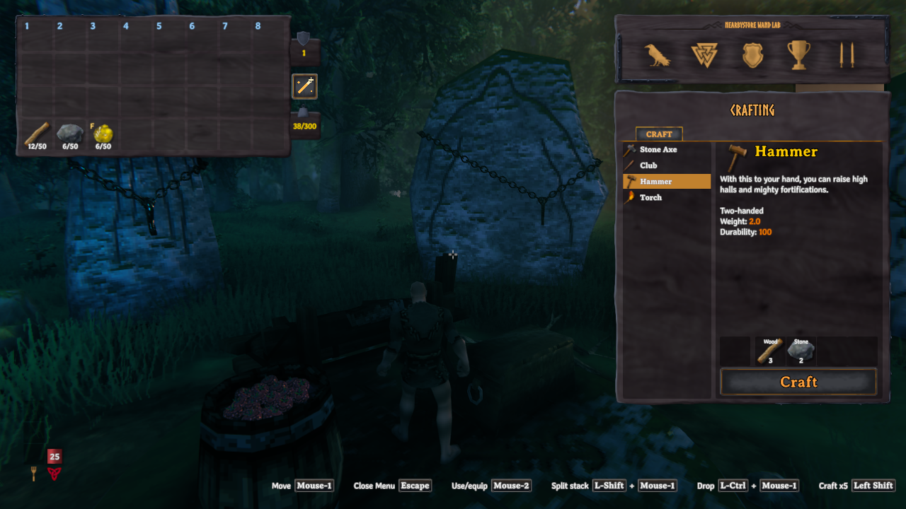
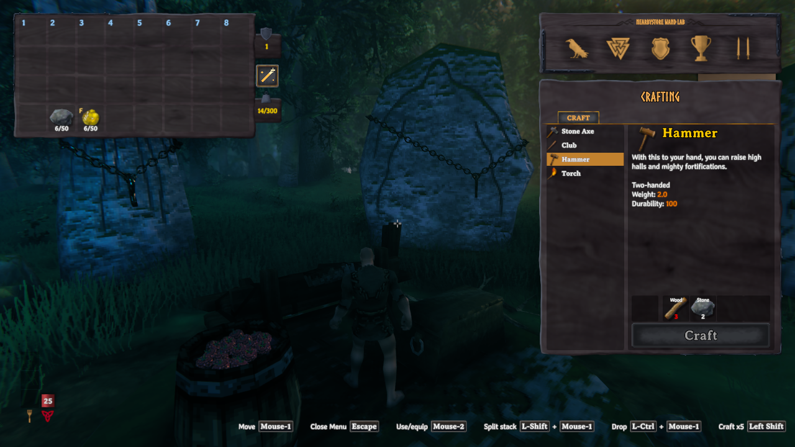

# NearbyStore

Stack items into nearby matching chests with one click, and favorite stacks you want to keep.

## Core features

- **One-click stacking:** a magic-wand button beside your inventory stores items
  in nearby placed chests. Requests start nearest first; ready chests can finish
  before nearer chests still awaiting ownership. Default range: **10 metres**.
- **Vanilla-style matching:** fill compatible stacks, then use free slots only in
  chests already holding that item. Empty or unrelated chests receive nothing;
  unmatched items and overflow stay carried.
- **Stack favorites:** press **Left Alt + F** over a player-inventory stack to
  toggle its gold **F** marker. Favorites, equipped, queued-for-equip and quest
  items stay carried. Unequipped hotbar items are eligible unless favorited.
- **Container rules respected:** checks privacy, wards, busy state and ownership;
  excludes tombstones, dropped loot and non-Piece containers. Search includes
  chests through walls and between floors.
- **Bounded storage work:** skip full destinations that cannot accept an item
  and spread transfers across frames while waiting on up to four chests.

## Screenshots

| Before stacking | After stacking |
| --- | --- |
|  |  |
| Wood is ready to store. The gold F marks resin as a favorite. | Wood has left the inventory. Stone and favorited resin stay carried. |

## Use

Open your inventory and click the **magic-wand icon** to its right. Close any
container, crafting station or blocking overlay first. The ordinary basic
crafting list is allowed. Closing inventory or opening a blocking UI cancels
remaining transfers without undoing completed transfers.

Only stacks carried when you click are considered; newly added stacks wait for
the next click. Favorites and chest access are checked again before each transfer.
An unresponsive chest is skipped after five seconds of waiting; the operation
ends after 15 seconds. Completed transfers remain stored. Click again to retry
items left in your inventory.

Favorites follow stacks when moved or split. **Manual merging keeps the
destination stack's marker**, so merging a favorite into an unmarked stack can
remove its protection. Re-favorite the merged stack if needed.

## Configuration

First load creates `BepInEx/config/jarki.nearbystore.cfg`. Edit while the game is
closed:

```ini
[Storage]
Radius = 10

[Controls]
FavoriteShortcut = F + LeftAlt
```

Radius is in metres, constrained to 1–50. The favorite shortcut remains configurable;
no shortcut hint is displayed.
Favorites can be toggled in the player inventory even while a chest is open;
storing requires the chest to be closed.

## Requirements and installation

Requires Valheim and **denikson-BepInExPack_Valheim 5.4.2351**.
**Client-side only:** no server installation or Jotunn dependency.

- **Mod manager:** install `Jarki-NearbyStore` and accept its BepInEx dependency.
- **Manual:** with Valheim closed and a working OS-appropriate BepInEx loader,
  copy the archive's plugin folder into `BepInEx/plugins/`. New packages use
  `BepInEx/plugins/Jarki-NearbyStore/NearbyStore.dll`; older archives use
  `BepInEx/plugins/NearbyStore/NearbyStore.dll`. Remove the previous DLL when
  upgrading; never keep both copies. Native Linux uses Linux Doorstop.

## Uninstall

Close Valheim and remove `NearbyStore.dll` from its plugin folder; remove
`BepInEx/config/jarki.nearbystore.cfg` separately if desired. No custom items or
world objects are added. Favorite markers are inert without the plugin;
already deposited items remain in their chests.

## Compatibility and troubleshooting

- **Delayed chest responses:** vanilla Stack items waits while that same chest
  has an unresolved NearbyStore request. Normal opening remains available;
  after taking ownership by opening it, close it and retry the wand.
- **Multiplayer:** controlled ownership-delay scenarios were checked in a local
  world; real two-client networking and disconnect recovery remain unverified.
- **OdinsFoodBarrels:** container restrictions remain active. Empty barrels need
  an initial item, just like vanilla Stack items. Custom barrel settings and
  other versions may differ.
- **Missing UI or errors:** [report an issue](https://github.com/Jarki/valheim-mods/issues)
  with game/mod versions, reproduction steps and redacted
  `BepInEx/LogOutput.log` entries. Never post private saves, passwords or tokens.
